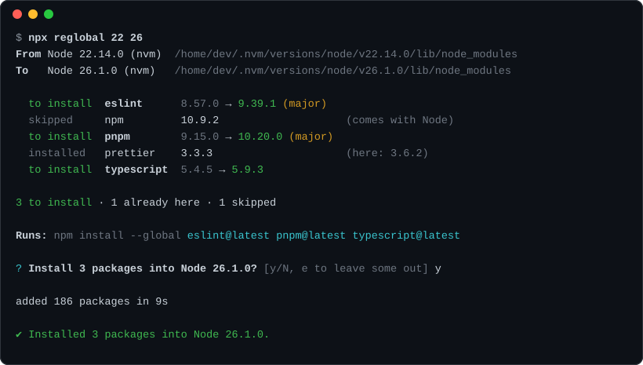

# reglobal

> Not on npm yet: the npm badge starts working with the first npm release.

[](https://github.com/piyook/reglobal/releases)
[](https://github.com/piyook/reglobal/actions/workflows/checks.yaml)
[](https://www.npmjs.com/package/reglobal)
[](https://nodejs.org)
[](package.json)
[](https://opensource.org/licenses/MIT)

Moved to a new Node version and lost your global packages? reglobal copies them across in one command.

```sh
npx reglobal 24.22.3 26.13.1
```



It reads the old version's global packages straight from its folder, shows you what will move and to which version, asks once, then installs them all into the new version with a single `npm install --global`.

- Works with fnm, nvm, nvm-windows, mise, asdf and n, or any other manager by pointing it at a folder.
- Shows the version each package moves to, and flags new major versions.
- Leave packages out with a checklist (`-i`), a flag (`--skip`) or at the question.
- The old Node and npm never run, so it works even when they're broken.
- Made for agents too: `--json` output, `--dry-run`, `--yes`, and clear exit codes.
- Coming: `export` and `import`, to move the list between machines.

No dependencies. Needs Node 22 or newer. Works on Windows, macOS and Linux.

## Usage

```sh
npx reglobal <old> [<new>] [options]
```

```sh
npx reglobal 24.22.3 26.13.1   # from Node 24.22.3 into Node 26.13.1
npx reglobal 24 26             # the same, picking the newest installed 24.x and 26.x
npx reglobal 24                # from 24 into the Node you're using now
npx reglobal                   # from the newest other version into the Node you're using now
```

A version is `24`, `24.1` or `24.1.0` (the newest installed match), or the path to a version's folder. Without `<new>`, reglobal installs into the Node in use. With it, reglobal runs that version's own node and npm, so you don't need to switch to it first.

reglobal always shows the list and asks before installing anything:

```text
? Install 3 packages into Node 26.1.0? [y/N, e to leave some out]
```

`y` installs, `e` lets you type the names of packages to leave out, and anything else cancels.

### Why npx

Use `npx reglobal` rather than installing it. A global install of reglobal belongs to one Node version, so after a switch it's missing from the new one, like your other globals. `npm install -g reglobal` still works if you'd like it installed: run `reglobal` in place of `npx reglobal`.

## Options

| Option | What it does |
| --- | --- |
| `--list` | Show what the old version has and the new one hasn't. Installs nothing. |
| `--dry-run` | Show the list and the npm command it would run. Installs nothing. |
| `-i`, `--interactive` | Tick and untick packages in a checklist (arrow keys, space, enter) before installing. |
| `--skip <names>` | Leave these packages out: `--skip eslint,pnpm`. |
| `--only <names>` | Install just these packages. |
| `--keep-versions` | Install the same versions as before, not the latest. |
| `--offline` | Don't look up the latest versions on the registry. |
| `-y`, `--yes` | Don't ask (for scripts and agents). |
| `--json` | Print JSON on stdout (see [llms.txt](llms.txt)). |
| `--from <v>`, `--to <v>` | The same as `<old>` and `<new>`. |

## What gets moved

- **Registry packages** are installed at `@latest`, or at the old version with `--keep-versions`. The list shows each move as `8.57.0 → 9.39.1`, and `(major)` marks a new major version, which can break things.
- **Packages from git** come back from git, at the latest commit, or at the same commit with `--keep-versions`.
- **npm and corepack** are left alone, since they come with Node.
- **`npm link` folders and packages from a local file** are listed with a warning, not reinstalled.
- **Packages already in the new version** are left as they are.

## Exit codes

| Code | Meaning |
| --- | --- |
| `0` | Done (or a list or dry run was shown). |
| `1` | Error: no such version, npm failed, or `--yes` was needed. |
| `2` | Nothing to install. |
| `3` | Cancelled. |

## For agents

`llms.txt` has the full reference, and `skills/reglobal/SKILL.md` is a ready-made skill. In short: preview with `npx reglobal 24 26 --dry-run --json`, show the user the plan, then run the same command with `--yes` (and `--skip` for anything they left out). Without `--yes`, and with no terminal, reglobal installs nothing and exits 1.

## License

MIT
